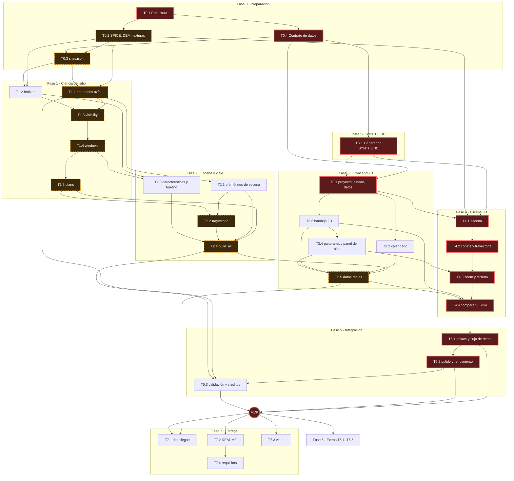

# PolePlanner v2.0 · Guía de desarrollo

Traduce la sección 10 de [SPEC.md](SPEC.md) (fuente de verdad) a subtareas de 1 a 3 horas.
Si esta guía contradice la spec, manda la spec: corrige la guía y anótalo en `PROGRESS.md`.

## Cómo usar esta guía

**Estados** (en el encabezado de cada subtarea):
`[ ]` pendiente · `[~]` en curso · `[x]` hecha · `[!]` bloqueada (añadir una línea `- **Bloqueo:** motivo`).

**Formato de cada subtarea:**

```
  ##### [ ] T1.2.a — Título
  - **Qué:** descripción.
  - **Archivos:** que crea o modifica.
  - **Depende de:** IDs · **Spec:** secciones · **Decisiones:** Dn de docs/DECISIONS.md · **Est.:** horas
  - **Aceptación:** comando, prueba o revisión visual concreta.
```

(En el archivo real, el encabezado empieza en la columna 0.)

Marcas opcionales en la línea de dependencias:
- **Adelantable**: no necesita datos de la fase anterior (lógica pura probada con datos sintéticos, la Pista S o front end sobre datos SYNTHETIC). Puede hacerse antes de cerrar la fase anterior (sección 14 de la spec: desarrollar la interfaz en paralelo).
- **Humano**: necesita una acción humana (cuenta de hosting, revisión visual, grabación). El agente prepara todo lo posible y la marca `[!]` hasta recibir la confirmación en el chat.

**Regla de elegibilidad** (paso b del protocolo de sesión en `CLAUDE.md`). Una subtarea es elegible si:
1. está en `[ ]`;
2. todas sus dependencias están en `[x]`;
3. todas sus decisiones están en estado **confirmada** en `docs/DECISIONS.md`;
4. su fase es la primera fase sin cerrar, o lleva la marca **Adelantable** (regla de la sección 10: no avanzar de fase sin cumplir los criterios de la actual).

Se toma la **primera elegible en el orden de este documento**. El orden prioriza la ciencia: Fase 0 → Fase 1 → Pista S → Fase 2 → Fase 3 → … La Pista S y las subtareas adelantables solo se adelantan si la pista principal está bloqueada.

**Cierre de fase:** cuando todas las subtareas de una fase están en `[x]`, se ejecuta su hito de demo y el agente se detiene (paso g).

**Fecha de corte:** desde el 2026-11-10, la Fase 7 tiene prioridad sobre la Fase 6.

**Contar estados:**

```bash
grep -cE '^##### \[ \]' docs/DEVELOPMENT_GUIDE.md   # pendientes (cambiar el símbolo para x, ~, !)
```

**Convenciones:** todo en UTC; ángulos en grados; los datos sintéticos se marcan **SYNTHETIC** y las trayectorias no reales **ILLUSTRATIVE** (reglas 1 y 2). `pipeline/out/` guarda los intermedios (no versionado); las figuras de verificación que se citan van a `docs/figures/`.

## Calendario propuesto

Hoy: 2026-10-20. Entrega: **2026-11-13** (24 días). Se ajusta cuando D1 (habilidades y horas) esté confirmada.

| Fase | Ventana objetivo | Nota |
|---|---|---|
| 0 Preparación | 20–22 oct | Depende de D3, D4, D6, D7, D12, D13 |
| 1 Núcleo científico | 23–28 oct | La lógica pura se adelanta mientras se descargan los datos |
| S Datos SYNTHETIC | en paralelo tras T0.4 | Desbloquea el front end |
| 2 Datos de escena y viaje | 29 oct–1 nov | |
| 3 Front end 2D | 26 oct–4 nov | Sobre SYNTHETIC; se cierra con datos reales (T3.5) |
| 4 Escena 3D | 2–8 nov | |
| 5 Integración y pulido | 8–11 nov | **Congelación del MVP: 11 nov** |
| 6 Extras | solo si el MVP está sólido antes del 8 nov | |
| 7 Entrega | 10–13 nov | Desplegar el shell 2D antes (T7.1.a es adelantable) |

---

## Fase 0: Preparación

### T0.1 Estructura del repositorio, README y PROGRESS (spec 7.1, 10)

Las carpetas vacías de 7.1 (con `.gitkeep`), `PROGRESS.md`, `CLAUDE.md` y `.gitignore` se crearon en la sesión de arranque.

##### [x] T0.1.a — README.md raíz
- **Qué:** README en inglés con: qué es (5 líneas), estructura del repositorio, requisitos (Python 3.11+, Node), cómo ejecutar el pipeline y el front end (comandos marcados "TBD" hasta que existan) y créditos provisionales (NASA/LOLA, NAIF/SPICE, JPL Horizons).
- **Archivos:** `README.md`
- **Depende de:** — · **Spec:** 7.1, 10 (T0.1), 11 regla 12 · **Decisiones:** — · **Est.:** 1 h
- **Aceptación:** `git ls-files` muestra todas las carpetas de 7.1; README tiene las secciones "Pipeline", "Front end" y "Data sources & credits".

##### [x] T0.1.b — Entorno Python del pipeline con versiones fijadas
- **Qué:** dependencias directas (numpy, spiceypy, rasterio o similar, pyproj, pandas, pydantic, matplotlib, pytest) y lista fijada con `==`; paquete `pipeline` importable desde la raíz; configuración de pytest; prueba de humo que importa todo. Comprobar que hay wheels para la versión de Python instalada en Windows (3.13); si rasterio falla, documentar la alternativa.
- **Archivos:** `pipeline/requirements.in`, `pipeline/requirements.txt`, `pipeline/__init__.py`, `pyproject.toml` (solo configuración de pytest), `pipeline/tests/test_smoke.py`
- **Depende de:** T0.1.a · **Spec:** 11 (pila, regla 5) · **Decisiones:** — · **Est.:** 1.5 h
- **Aceptación:** en un venv nuevo, `python -m pip install -r pipeline/requirements.txt` termina sin error y `python -m pytest -q` muestra la prueba de humo pasada.

##### [x] T0.1.c — Esqueleto del front end (Vite + React + TypeScript + Vitest)
- **Qué:** proyecto Vite React-TS en `web/` con versiones exactas (sin `^`) y `package-lock.json`; scripts `dev`, `build`, `test`, `typecheck`; página provisional "PolePlanner" en inglés; prueba trivial.
- **Archivos:** `web/package.json`, `web/package-lock.json`, `web/tsconfig*.json`, `web/vite.config.ts`, `web/index.html`, `web/src/main.tsx`, `web/src/App.tsx`, `web/tests/smoke.test.ts`
- **Depende de:** T0.1.a · **Spec:** 7, 11 (pila) · **Decisiones:** D2 · **Est.:** 1.5 h
- **Aceptación:** `npm --prefix web ci`, `npm --prefix web run typecheck`, `npm --prefix web test` y `npm --prefix web run build` terminan con código 0; `npm --prefix web run dev` responde HTTP 200.

##### [x] T0.1.d — Comandos definitivos y prueba desde un clon limpio
- **Qué:** sustituir los "por definir" de instalar, tests, servidor de desarrollo y build en `CLAUDE.md` y `README.md`; clonar el repositorio en una carpeta temporal y ejecutar todo desde cero.
- **Archivos:** `CLAUDE.md`, `README.md`
- **Depende de:** T0.1.b, T0.1.c · **Spec:** 10 (T0.1), 11 regla 5 · **Decisiones:** — · **Est.:** 1 h
- **Aceptación:** la salida de `git clone` + instalación + tests + build desde el clon temporal, toda en verde, queda pegada en `PROGRESS.md`.

### T0.4 (añadida) Contrato de datos de la sección 7.2

Desbloquea el trabajo en paralelo: el pipeline, la Pista S y el front end programan contra el mismo contrato.

##### [x] T0.4.a — docs/DATA_CONTRACT.md
- **Qué:** especificar, campo a campo, cada archivo de 7.2: tipo, unidad, rango, obligatoriedad, longitud de los arrays, formato de fecha (ISO 8601 UTC con `Z`), cuantización (decidir: enteros en centésimas de grado con factor de escala explícito, o floats), convención del cuaternión (orden de componentes, marco origen y destino), marcos de coordenadas, convención de ids (sitio, plan y `trajectory_id` según D6), `contract_version`, y en `manifest.json`: versión, parámetros (paso, h_obs, margen de antena, criterio del Sol, modo de trayectoria, modo de escala), rango de fechas y `data_status: "REAL" | "SYNTHETIC"` (extensión para cumplir la regla 1; documentarla). Añadir las comprobaciones entre archivos.
- **Archivos:** `docs/DATA_CONTRACT.md`
- **Depende de:** T0.1.a · **Spec:** 7.2, 5.1, 5.8 · **Decisiones:** D6, D7 · **Est.:** 2.5 h
- **Aceptación:** los 10 tipos de archivo de 7.2 (sites, plans, horizon, timeseries, daily, windows, scene/ephemeris, trajectory, site_features, terrain) y `manifest.json` están documentados; un grep de cada nombre de campo de 7.2 lo encuentra en el documento.

##### [x] T0.4.b — Validación en Python
- **Qué:** modelos pydantic v2 y CLI que valida un directorio completo o un archivo, con comprobaciones entre archivos (ids de sitio existentes, longitudes de arrays coherentes, `launch_utc = arrival_utc − transit_days`). Fixtures mínimas válidas e inválidas, marcadas SYNTHETIC.
- **Archivos:** `pipeline/contract.py`, `pipeline/validate.py`, `pipeline/tests/test_contract.py`, `pipeline/tests/fixtures/contract/**`
- **Depende de:** T0.4.a, T0.1.b · **Spec:** 7.2 · **Decisiones:** — · **Est.:** 3 h
- **Aceptación:** `python -m pytest pipeline/tests/test_contract.py -v` pasa: las fixtures válidas se aceptan y al menos una inválida por tipo de archivo se rechaza con un mensaje claro; `python -m pipeline.validate pipeline/tests/fixtures/contract/valid` termina en 0.

##### [x] T0.4.c — Tipos TypeScript y validación en el front end
- **Qué:** esquemas zod equivalentes con tipos inferidos; prueba de paridad que valida las mismas fixtures de `pipeline/tests/fixtures/contract/` (válidas aceptadas, inválidas rechazadas).
- **Archivos:** `web/src/lib/contract.ts`, `web/tests/contract.test.ts`, `web/package.json`
- **Depende de:** T0.4.b, T0.1.c · **Spec:** 7.2, 10 (T3.1) · **Decisiones:** — · **Est.:** 2.5 h
- **Aceptación:** `npm --prefix web test -- contract` pasa con los mismos resultados (aceptado/rechazado) que pytest; `npm --prefix web run typecheck` sin errores.

### T0.2 Datos externos: SPICE, DEM y texturas (spec 6, 10)

##### [x] T0.2.a — Identificar los kernels SPICE (verificación)
- **Qué:** en el servidor de NAIF, identificar los kernels exactos: SPK planetario (la spec sugiere DE440), LSK, PCK de texto, PCK binario de orientación lunar y FK lunar (para MOON_ME o MOON_PA), y lo necesario para la orientación de la Tierra en la escena (T2.1). Registrar nombre exacto, URL, tamaño, cobertura declarada y condiciones de uso. No escribir ningún nombre que no se haya visto en el servidor.
- **Archivos:** `data/README.md`
- **Depende de:** T0.1.a · **Spec:** 5.1, 6 · **Decisiones:** D4 · **Est.:** 2 h
- **Aceptación:** tabla en `data/README.md` con todos los tipos de kernel; cada URL responde HTTP 200 (salida de la comprobación mostrada).

##### [x] T0.2.b — Descarga reproducible y meta-kernel
- **Qué:** `pipeline/fetch_data.py` descarga de forma idempotente a `data/kernels/`, calcula y verifica SHA-256 contra `pipeline/data_sources.json`; meta-kernel con rutas relativas.
- **Archivos:** `pipeline/fetch_data.py`, `pipeline/data_sources.json`, `pipeline/spice/poleplanner.tm`, `data/README.md`
- **Depende de:** T0.2.a, T0.1.b · **Spec:** 6, 11 regla 5 · **Decisiones:** — · **Est.:** 2 h
- **Aceptación:** `python -m pipeline.fetch_data --kernels` descarga y verifica; una segunda ejecución informa "present, checksum OK" para cada archivo; los checksums quedan en `data/README.md`.

##### [x] T0.2.c — Carga SPICE y cobertura temporal
- **Qué:** prueba que carga el meta-kernel, calcula la posición de la Luna respecto a la Tierra en un instante del rango y la rotación MOON_ME (o MOON_PA) → J2000; comprueba con spkcov/pckcov que la cobertura incluye el rango de D4 más el margen de `transit_days` anterior.
- **Archivos:** `pipeline/spice_utils.py`, `pipeline/tests/test_spice_load.py`
- **Depende de:** T0.2.b · **Spec:** 5.1, 10 (T0.2) · **Decisiones:** D4 · **Est.:** 1.5 h
- **Aceptación:** `python -m pytest pipeline/tests/test_spice_load.py -v` pasa; la distancia Tierra–Luna calculada está entre ~356 000 y ~407 000 km; la cobertura incluye todo el rango.

##### [x] T0.2.d — Identificar el producto DEM LOLA del polo sur (verificación)
- **Qué:** en el PDS Geosciences Node, elegir el producto LOLA de polo sur (80°S–90°S) con resolución de decenas de m/píxel. Registrar ID del producto, URL, resolución, proyección (parámetros del label), radio de referencia de las alturas, tamaño y cita. Valorar tamaño frente a tiempo de cómputo (R_max = 100 km).
- **Archivos:** `data/README.md`
- **Depende de:** T0.1.a · **Spec:** 5.2, 6 · **Decisiones:** D3 · **Est.:** 2 h
- **Aceptación:** `data/README.md` contiene el producto con URL comprobada (HTTP 200) y resolución, proyección y radio de referencia copiados del label.

##### [~] T0.2.e — Descargar el DEM y verificar su lectura
- **Qué:** añadir el DEM a `fetch_data.py`; `pipeline/inspect_dem.py` imprime CRS, tamaño, resolución, rango de alturas y el valor cerca del polo.
- **Archivos:** `pipeline/fetch_data.py`, `pipeline/data_sources.json`, `pipeline/inspect_dem.py`, `data/README.md`
- **Depende de:** T0.2.d, T0.2.b · **Spec:** 6 · **Decisiones:** — · **Est.:** 2 h
- **Aceptación:** `python -m pipeline.inspect_dem` imprime un CRS polar estereográfico, una resolución igual a la del label y un rango de alturas plausible (unos pocos km alrededor del radio de referencia); checksum registrado.

##### [ ] T0.2.f — Texturas de la Tierra y la Luna (verificación de licencia)
- **Qué:** identificar mapas globales publicados por NASA (SVS, LRO) para la Tierra y la Luna, verificar licencia y resolución, elegir tamaños dentro del presupuesto D13 y añadirlos a `fetch_data.py`. La conversión a formatos web se hace en T4.1.c.
- **Archivos:** `pipeline/fetch_data.py`, `pipeline/data_sources.json`, `data/README.md`
- **Depende de:** T0.2.b · **Spec:** 6, 8.7, 11 regla 12 · **Decisiones:** D13 · **Est.:** 1.5 h
- **Aceptación:** `data/README.md` lista cada textura con URL, licencia citada y tamaño; la suma cabe en la parte del presupuesto asignada a texturas.

### T0.3 Sitios candidatos: sites.json (spec 6.1)

##### [ ] T0.3.a — Fuentes oficiales de los sitios (verificación)
- **Qué:** para cada sitio de D3, encontrar el listado oficial o la publicación que lo define y registrar la cita. Si la fuente define regiones y no puntos, definir y documentar el método de elección del punto dentro de la región (con el DEM). Ninguna coordenada sin fuente.
- **Archivos:** `docs/sites.md`
- **Depende de:** T0.2.d · **Spec:** 6.1, 5.10, 11 regla 1 · **Decisiones:** D3 · **Est.:** 2.5 h
- **Aceptación:** `docs/sites.md` tiene, por sitio: nombre, cita verificable, coordenadas tal como las da la fuente (o el método de elección) y fecha de consulta.

##### [ ] T0.3.b — Generar pipeline/sites.json
- **Qué:** `pipeline/make_sites.py` lee las coordenadas con fuente, toma `elevation_m` del DEM (bilineal) y escribe `sites.json` según el contrato, con ids estables (slug).
- **Archivos:** `pipeline/make_sites.py`, `pipeline/sites_source.json`, `pipeline/sites.json`
- **Depende de:** T0.3.a, T0.2.e, T0.4.b · **Spec:** 6.1, 7.2 · **Decisiones:** D3 · **Est.:** 1.5 h
- **Aceptación:** `python -m pipeline.make_sites` y luego `python -m pipeline.validate --file pipeline/sites.json` terminan en 0; hay 4 o 5 sitios con `lat`, `lon`, `elevation_m` y `source` no vacíos.

##### [ ] T0.3.c — Mapa de verificación de los sitios
- **Qué:** sombreado del DEM con los sitios marcados, para revisarlo contra mapas oficiales.
- **Archivos:** `pipeline/plots/sites_map.py`, `docs/figures/sites_map.png`
- **Depende de:** T0.3.b · **Spec:** 6.1 · **Decisiones:** — · **Est.:** 1 h
- **Aceptación:** imagen generada; revisión visual anotada en `PROGRESS.md` (cada sitio cae sobre el rasgo esperado: borde, macizo o cresta).

### Hito de demo · Fase 0

**Qué se puede mostrar:** repositorio que instala y compila desde cero; kernels, DEM y texturas descargados con checksums; mapa del DEM con los sitios; contrato de datos validado en Python y TypeScript.
**Cómo probarlo:**

```bash
python -m pytest pipeline/tests -v
python -m pipeline.validate pipeline/tests/fixtures/contract/valid
npm --prefix web test
npm --prefix web run dev
```

Abrir `docs/figures/sites_map.png`.

---

## Fase 1: Núcleo científico del sitio (pipeline)

Esta fase nunca se recorta (spec 1, 11 regla 6).

### T1.1 ephemeris.py: az/el del Sol y la Tierra en ENU (spec 5.1)

##### [ ] T1.1.a — Referencias de JPL Horizons (verificación)
- **Qué:** averiguar cómo pedir a Horizons una tabla de observador para un punto de la superficie lunar (coordenadas del sitio sobre el cuerpo 301) con azimut y elevación del Sol y de la Tierra, sin refracción, y qué corrección aplica (aparente o astrométrica) para igualarla a LT+S. Comprobar el radio o la forma de referencia que usa Horizons frente al del DEM y su convención de azimut. Obtener al menos 5 instantes × 2 sitios repartidos por el rango D4 y guardar la salida cruda con los parámetros de la consulta.
- **Archivos:** `pipeline/tests/reference/horizons_*.txt`, `pipeline/horizons_fetch.py` (opcional), `docs/validation.md`
- **Depende de:** T0.3.b · **Spec:** 5.1, 5.7, 6, 10 (T1.1) · **Decisiones:** D3, D4 · **Est.:** 2.5 h
- **Aceptación:** archivos de referencia guardados con su encabezado de consulta; `docs/validation.md` describe interfaz, parámetros, radio de referencia y convención de azimut (y la conversión si no es N→E).

##### [ ] T1.1.b — Observador y marco ENU
- **Qué:** posición del observador en el marco lunar (MOON_ME o MOON_PA: elegir y documentar) desde lat, lon y radio = radio de referencia del DEM + `elevation_m` + h_obs; base ENU en ese punto.
- **Archivos:** `pipeline/ephemeris.py`, `pipeline/tests/test_enu.py`
- **Depende de:** T0.2.c, T0.3.b · **Spec:** 5.1 · **Decisiones:** D12 · **Est.:** 2 h
- **Aceptación:** `python -m pytest pipeline/tests/test_enu.py -v` pasa: base ortonormal (error < 1e-12), U radial, E × N = U, N apunta al polo norte proyectado en un punto de prueba.

##### [ ] T1.1.c — Az/el del Sol y la Tierra, vectorizado
- **Qué:** vectores del Sol y la Tierra respecto al observador con corrección LT+S (spkpos como dice 5.1, o spkcpo para un observador en superficie: documentar), transformación a ENU, azimut 0–360° desde el Norte hacia el Este y elevación, sobre una rejilla temporal.
- **Archivos:** `pipeline/ephemeris.py`, `pipeline/tests/test_ephemeris.py`
- **Depende de:** T1.1.b · **Spec:** 5.1, 5.7 · **Decisiones:** — · **Est.:** 3 h
- **Aceptación:** prueba para un sitio y 30 días a 30 min: la elevación del Sol queda en [−1.6°, +1.6°], la de la Tierra a pocos grados del horizonte y los azimuts en [0, 360).

##### [ ] T1.1.d — Comparación contra Horizons
- **Qué:** prueba que compara contra las referencias de T1.1.a y escribe la tabla de errores (borrador) en `docs/validation.md`. Error medido como separación angular, o en elevación y azimut·cos(el) (documentar).
- **Archivos:** `pipeline/tests/test_vs_horizons.py`, `docs/validation.md`
- **Depende de:** T1.1.a, T1.1.c · **Spec:** 5.7, 10 (T1.1) · **Decisiones:** — · **Est.:** 2 h
- **Aceptación:** `python -m pytest pipeline/tests/test_vs_horizons.py -v` pasa con error < 0.05° para el Sol y la Tierra en al menos 5 instantes por sitio; la tabla con la salida real está en `docs/validation.md`.

##### [ ] T1.1.e — Series de un año para todos los sitios
- **Qué:** az/el del Sol y la Tierra para el rango D4 con paso de 30 min (parametrizable a 10) para todos los sitios; intermedios en `pipeline/out/`; figura de verificación de las elevaciones a lo largo del año.
- **Archivos:** `pipeline/ephemeris.py`, `docs/figures/ephemeris_{site}.png`
- **Depende de:** T1.1.d · **Spec:** 5.1, 5.7 · **Decisiones:** D4 · **Est.:** 2 h
- **Aceptación:** el comando imprime el tiempo de ejecución y el mínimo y máximo de `sun_el` y `earth_el` por sitio, dentro de los rangos de 5.7; figuras generadas.

### T1.2 horizon.py: máscara de horizonte (spec 5.2)

##### [ ] T1.2.a — Utilidades de DEM y proyección
- **Qué:** conversión lat/lon ↔ x/y del DEM con el CRS del label, muestreo bilineal y tamaño de píxel.
- **Archivos:** `pipeline/dem.py`, `pipeline/tests/test_dem.py`
- **Depende de:** T0.2.e · **Spec:** 5.2 (notas) · **Decisiones:** — · **Est.:** 2 h
- **Aceptación:** pruebas: ida y vuelta lat/lon → x/y → lat/lon con error < 1 m; un punto de referencia del label (por ejemplo, el centro de proyección) cae donde indica el label.

##### [x] T1.2.b — DEM sintético de prueba (cráter conocido)
- **Qué:** generador de un DEM sintético (cráter con borde de altura H a distancia D) en el mismo formato que el real y fórmula analítica de la elevación esperada del horizonte, con el término de curvatura d²/(2·R_luna).
- **Archivos:** `pipeline/tests/synthetic_dem.py`, `pipeline/tests/test_synthetic_dem.py`
- **Depende de:** T0.1.b · **Spec:** 5.2 · **Decisiones:** — · **Est.:** 1.5 h · **Adelantable**
- **Aceptación:** prueba que verifica el generador (altura del borde y radio en el raster) e imprime la elevación analítica para 3 casos.

##### [ ] T1.2.c — Algoritmo de la máscara de horizonte
- **Qué:** trazado de rayos por bin de 1° hasta R_max = 100 km, paso ≈ tamaño de píxel, fórmula de 5.2 con h_obs; elegir y documentar el recorte (`max(0, ·)` o conservar negativos).
- **Archivos:** `pipeline/horizon.py`, `pipeline/tests/test_horizon.py`
- **Depende de:** T1.2.a, T1.2.b · **Spec:** 5.2 · **Decisiones:** D12 · **Est.:** 3 h
- **Aceptación:** `python -m pytest pipeline/tests/test_horizon.py -v`: el DEM sintético da la elevación analítica en los 360 bins con error < 0.05° (tolerancia propuesta; justificar por la discretización).

##### [ ] T1.2.d — Rendimiento de la máscara
- **Qué:** vectorizar con numpy; objetivo propuesto: < 2 min por sitio con el DEM real (documentar el valor alcanzado).
- **Archivos:** `pipeline/horizon.py`
- **Depende de:** T1.2.c · **Spec:** 8.7, 14 · **Decisiones:** — · **Est.:** 2 h
- **Aceptación:** tiempo por sitio impreso; las pruebas de T1.2.c siguen pasando.

##### [ ] T1.2.e — Máscaras de los sitios reales y gráficos
- **Qué:** máscaras de todos los sitios, figuras lineal y polar, máximo por sitio.
- **Archivos:** `pipeline/horizon.py`, `docs/figures/horizon_{site}.png`
- **Depende de:** T1.2.d, T0.3.b · **Spec:** 5.2, 10 (T1.2) · **Decisiones:** D12 · **Est.:** 2 h
- **Aceptación:** figuras generadas; máximos por sitio impresos y plausibles (pocos grados); revisión visual anotada en `PROGRESS.md`.

### T1.3 visibility.py: banderas Sol y Tierra (spec 5.3, 5.4)

##### [x] T1.3.a — Visibilidad del Sol (borde superior)
- **Qué:** `sun_visible = (sun_el + 0.265°) > horizon_el[sun_az]`, con interpolación de la máscara en azimut (lineal entre bins, con paso por 359°→0°; documentar).
- **Archivos:** `pipeline/visibility.py`, `pipeline/tests/test_visibility.py`
- **Depende de:** T0.1.b · **Spec:** 5.3 · **Decisiones:** — · **Est.:** 1.5 h · **Adelantable**
- **Aceptación:** pruebas de casos límite: borde justo encima y debajo de la máscara (±1e-6°), azimut 359.9° y 0.1°, máscara negativa.

##### [x] T1.3.b — Visibilidad de la Tierra con margen de antena
- **Qué:** `earth_visible = earth_el > horizon_el[earth_az] + margen_antena` (centro de la Tierra); margen como parámetro; bandera opcional de visibilidad parcial (borde).
- **Archivos:** `pipeline/visibility.py`, `pipeline/tests/test_visibility.py`
- **Depende de:** T1.3.a · **Spec:** 5.4 · **Decisiones:** D12 · **Est.:** 1 h · **Adelantable**
- **Aceptación:** pruebas con elevación = máscara + margen ± ε y con distintos márgenes.

##### [x] T1.3.c — (Recortable) Fracción visible del disco solar
- **Qué:** fracción 0–1 del disco sobre la máscara; umbral 0.5 como "día" (parámetro). El criterio por defecto sigue siendo el del borde superior; el criterio usado se escribe en el manifiesto y se muestra en la interfaz.
- **Archivos:** `pipeline/visibility.py`, `pipeline/tests/test_visibility.py`
- **Depende de:** T1.3.a · **Spec:** 5.3 · **Decisiones:** — · **Est.:** 2 h · **Adelantable**
- **Aceptación:** pruebas con fracción 0, 0.5 y 1 sobre una máscara plana conocida.

##### [ ] T1.3.d — Banderas de todos los sitios y control de fondo de cráter
- **Qué:** aplicar las banderas a las series de T1.1.e con las máscaras de T1.2.e. Añadir un punto de control en un fondo de cráter (elegido del DEM y documentado; no es un sitio candidato) para el sanity check de 5.7.
- **Archivos:** `pipeline/visibility.py`, `docs/sites.md`
- **Depende de:** T1.3.b, T1.1.e, T1.2.e · **Spec:** 5.7 · **Decisiones:** — · **Est.:** 1.5 h
- **Aceptación:** tabla impresa de % de Sol y % de Tierra por sitio y para el control: el control tiene ~0% de Sol; los sitios de cresta, más que el control.

### T1.4 windows.py: métricas por ventana (spec 5.5, 5.6)

##### [x] T1.4.a — Agregados diarios
- **Qué:** por día UTC: `sun_pct`, `earth_h`, `longest_dark_h`, `longest_comm_gap_h`.
- **Archivos:** `pipeline/windows.py`, `pipeline/tests/test_windows.py`
- **Depende de:** T0.1.b · **Spec:** 5.5, 7.2 (daily) · **Decisiones:** — · **Est.:** 2 h · **Adelantable**
- **Aceptación:** pruebas con series construidas a mano y resultado conocido, incluida una racha que cruza la medianoche UTC.

##### [x] T1.4.b — Ventanas deslizantes eficientes (L = 3, 7, 14)
- **Qué:** métricas de 5.5 con sumas acumuladas y rachas (run-length) que cruzan los límites de la ventana; `earth_h_per_day_min` y `earth_h_per_day_mean`.
- **Archivos:** `pipeline/windows.py`, `pipeline/tests/test_windows.py`
- **Depende de:** T1.4.a · **Spec:** 5.5, 10 (T1.4) · **Decisiones:** — · **Est.:** 3 h · **Adelantable**
- **Aceptación:** prueba aleatoria: 200 ventanas coinciden (diferencia < 1e-9) con un cálculo ingenuo.

##### [ ] T1.4.c — Puntuación y restricciones
- **Qué:** `score` de 5.6 con `norm` sobre el rango observado (documentar el ámbito: todos los sitios y llegadas para cada L), pesos como parámetros; función de restricciones X, Y, Z opcionales (referencia para la paridad con el front end).
- **Archivos:** `pipeline/windows.py`, `pipeline/tests/test_windows.py`
- **Depende de:** T1.4.b · **Spec:** 5.6 · **Decisiones:** — · **Est.:** 1.5 h · **Adelantable**
- **Aceptación:** pruebas: score en [0, 1]; subir `sun_pct` con lo demás fijo no baja el score; un control desactivado no filtra.

##### [ ] T1.4.d — Ejecución con datos reales y rendimiento
- **Qué:** daily y windows para todos los sitios y L.
- **Archivos:** `pipeline/windows.py`
- **Depende de:** T1.4.c, T1.3.d · **Spec:** 5.5, 10 (T1.4) · **Decisiones:** D4 · **Est.:** 1 h
- **Aceptación:** el comando para todos los sitios y L tarda < 1 min (tiempo impreso); las salidas pasan `python -m pipeline.validate`.

### T1.5 plans.json (spec 5.8)

##### [ ] T1.5.a — Generar plans.json
- **Qué:** planes según 5.8, D6 y D7: esquema de ids, `launch_utc = arrival_utc − transit_days`, `trajectory_id`.
- **Archivos:** `pipeline/plans.py`, `pipeline/plans.json`
- **Depende de:** T1.4.d · **Spec:** 5.8, 7.2 · **Decisiones:** D5, D6, D7 · **Est.:** 1.5 h
- **Aceptación:** `python -m pipeline.validate` pasa; el número de planes es el esperado según D6; la comprobación cruzada confirma lanzamiento derivado y sitio válido en todos.

##### [ ] T1.5.b — Suite automática de sanity checks (5.7)
- **Qué:** pruebas sobre las salidas reales (se saltan si no existen): rangos de elevación del Sol y la Tierra, cresta > fondo de cráter, porcentajes en [0, 100].
- **Archivos:** `pipeline/tests/test_sanity.py`
- **Depende de:** T1.5.a · **Spec:** 5.7, 11 regla 4 · **Decisiones:** — · **Est.:** 1 h
- **Aceptación:** `python -m pytest pipeline/tests/test_sanity.py -v` pasa sobre los datos reales.

##### [ ] T1.5.c — Informe de sitio para el hito
- **Qué:** comando que, para un plan (sitio, llegada, L), imprime las métricas de 5.5 y guarda una figura con la máscara y las trayectorias del Sol y la Tierra de la ventana.
- **Archivos:** `pipeline/report_site.py`
- **Depende de:** T1.5.a · **Spec:** 5.5, 8.4 · **Decisiones:** — · **Est.:** 1.5 h
- **Aceptación:** `python -m pipeline.report_site --site <id> --arrival <YYYY-MM-DD> --window 7` imprime las métricas y genera la figura; revisión visual.

### Hito de demo · Fase 1

**Qué se puede mostrar:** la ciencia completa de los sitios reales: máscaras de horizonte, Sol y Tierra validados contra JPL Horizons, banderas de visibilidad, métricas por ventana y planes.
**Cómo probarlo:**

```bash
python -m pytest pipeline/tests -v
python -m pipeline.report_site --site <id> --arrival <YYYY-MM-DD> --window 7
```

Revisar `docs/validation.md` (tabla de errores) y `docs/figures/horizon_*.png`.

---

## Pista S (paralela): datos SYNTHETIC para el front end

Permite desarrollar las Fases 3 y 4 sin esperar al pipeline (spec 14). Todo lo que genera lleva `data_status: "SYNTHETIC"` en el manifiesto y "SYNTHETIC" en los nombres de los sitios; el front end muestra un aviso permanente (T3.1.a). Nunca se mezcla con `web/public/data/`.

### TS.1 Generador de datos SYNTHETIC conforme a 7.2

##### [ ] TS.1.a — Sitios, horizontes y series SYNTHETIC
- **Qué:** 5 sitios ficticios (`syn_a`…`syn_e`, nombre "SYNTHETIC Site A"…, `source: "SYNTHETIC"`); máscaras procedurales distintas entre sí para que los paneles difieran; series de un año a 30 min con un movimiento del Sol y la Tierra generado por fórmulas simples, documentadas como no físicas; banderas con las reglas de 5.3 y 5.4; semilla fija; manifiesto con `data_status: "SYNTHETIC"`.
- **Archivos:** `pipeline/synthetic.py`, `web/public/data_synthetic/**`
- **Depende de:** T0.4.b · **Spec:** 14, 7.2, 11 regla 1 · **Decisiones:** — · **Est.:** 3 h · **Adelantable**
- **Aceptación:** `python -m pipeline.synthetic` y luego `python -m pipeline.validate web/public/data_synthetic` terminan en 0; el manifiesto y todos los nombres de sitio contienen "SYNTHETIC"; dos ejecuciones dan archivos idénticos (sha256).

##### [ ] TS.1.b — daily, windows y plans SYNTHETIC
- **Qué:** daily, windows y plans calculados desde las series sintéticas con una implementación ingenua propia (no depende de `windows.py`); `transit_days` de relleno marcado.
- **Archivos:** `pipeline/synthetic.py`, `web/public/data_synthetic/**`
- **Depende de:** TS.1.a · **Spec:** 5.5, 5.6, 5.8, 7.2 · **Decisiones:** — · **Est.:** 2 h · **Adelantable**
- **Aceptación:** `python -m pipeline.validate web/public/data_synthetic` termina en 0; `sun_pct` en [0, 100], `score` en [0, 1]; todos los planes cumplen `launch_utc = arrival_utc − transit_days`.

##### [ ] TS.1.c — Escena, trayectorias, características y terreno SYNTHETIC
- **Qué:** `scene/ephemeris.json` (órbita circular simple de la Luna, Sol que gira una vez por año, cuaterniones), trayectorias ILLUSTRATIVE simples, `site_features` con atributos "not available" o marcados SYNTHETIC, terreno procedural (cráter y cresta) en 2–3 LOD; `web/public/data_synthetic/README.md` (qué es, cómo regenerarlo). Si el total pesa < 5 MB se versiona; si no, se ignora en git y se genera.
- **Archivos:** `pipeline/synthetic.py`, `web/public/data_synthetic/**`
- **Depende de:** TS.1.b · **Spec:** 5.9, 5.10, 7.2 · **Decisiones:** — · **Est.:** 3 h · **Adelantable**
- **Aceptación:** validación completa (con comprobaciones cruzadas) en 0; tamaño total impreso; todas las trayectorias tienen `mode: "ILLUSTRATIVE"`.

### Hito de demo · Pista S

**Qué se puede mostrar:** un conjunto de datos completo y válido para el front end, claramente SYNTHETIC.
**Cómo probarlo:** `python -m pipeline.synthetic` y luego `python -m pipeline.validate web/public/data_synthetic`.

---

## Fase 2: Datos de la escena y del viaje

### T2.1 ephemeris.py en modo escena (spec 5.8, 7.2)

##### [ ] T2.1.a — Efemérides de escena
- **Qué:** muestreo cada 60 min (parámetro) de la posición de la Luna y la dirección del Sol en un marco común con centro en la Tierra (elegir y documentar), cuaternión de orientación lunar (marco lunar → marco común) y rotación de la Tierra (SPICE si hay kernel adecuado; si no, fórmula documentada). Rango: D4 más el margen de tránsito.
- **Archivos:** `pipeline/ephemeris.py`, `pipeline/out/scene/ephemeris.json`
- **Depende de:** T1.1.e · **Spec:** 5.8, 7.2 · **Decisiones:** D4 · **Est.:** 3 h
- **Aceptación:** `python -m pipeline.validate --file pipeline/out/scene/ephemeris.json` termina en 0; tamaño impreso.

##### [ ] T2.1.b — Convención del cuaternión
- **Qué:** prueba: rotar la posición del sitio en el marco lunar con el cuaternión del archivo y sumar la posición de la Luna reproduce la posición SPICE del sitio en el marco común; error de interpolación (slerp) a mitad de intervalo. Documentar el orden de componentes para three.js en `docs/DATA_CONTRACT.md`.
- **Archivos:** `pipeline/tests/test_scene.py`, `docs/DATA_CONTRACT.md`
- **Depende de:** T2.1.a · **Spec:** 5.9, 7.2 · **Decisiones:** — · **Est.:** 1.5 h
- **Aceptación:** `python -m pytest pipeline/tests/test_scene.py -v` pasa: error < 0.1 km en las muestras y < 1 km interpolado (tolerancia documentada).

##### [ ] T2.1.c — Fase lunar y dirección del Sol frente a una referencia
- **Qué:** en al menos 3 fechas, comparar la fracción iluminada de la Luna y la dirección del Sol con una referencia (Horizons, mismas cantidades).
- **Archivos:** `pipeline/tests/reference/`, `pipeline/tests/test_scene.py`, `docs/validation.md`
- **Depende de:** T2.1.a, T1.1.a · **Spec:** 10 (T2.1) · **Decisiones:** — · **Est.:** 2 h
- **Aceptación:** tabla en `docs/validation.md` con las diferencias (propuesta: < 0.5 puntos de fracción iluminada y < 0.1° en la dirección del Sol).

### T2.2 trajectory.py (spec 5.8)

##### [ ] T2.2.a — Kernel de misión publicado (verificación; solo si D5 = real)
- **Qué:** buscar en NAIF un SPK de una misión publicada que cubra el periodo; registrarlo o dejar constancia de que no existe. Si D5 = ilustrativa: marcar `[x]` con la nota "no aplica (D5)".
- **Archivos:** `data/README.md`
- **Depende de:** T0.2.a · **Spec:** 5.8, 6 · **Decisiones:** D5 · **Est.:** 1.5 h
- **Aceptación:** `data/README.md` registra el kernel verificado (URL y cobertura con spkcov) o la nota de que no hay uno válido; en ese caso se vuelve a D5 con el humano.

##### [ ] T2.2.b — Trayectoria ILLUSTRATIVE de un plan
- **Qué:** curva continua en el marco de la escena: ascenso (marca de despegue) → órbita de espera → inyección (marca) → arco simplificado (por ejemplo, cónicas empalmadas o retorno libre aproximado) hacia la posición SPICE de la Luna → aproximación y descenso hasta el sitio (marca de aterrizaje en `arrival_utc`). `mode: "ILLUSTRATIVE"`.
- **Archivos:** `pipeline/trajectory.py`, `pipeline/tests/test_trajectory.py`
- **Depende de:** T2.1.a, T1.5.a, T2.2.a · **Spec:** 5.8, 7.2 · **Decisiones:** D5 · **Est.:** 3 h
- **Aceptación:** pruebas: tiempos monótonos; sin saltos (distancia entre muestras consecutivas < umbral documentado); el último punto coincide con la posición SPICE del sitio en `arrival_utc` (< 1 km); `mode` correcto.

##### [ ] T2.2.c — Generación por lotes, tamaño y documentación ILLUSTRATIVE
- **Qué:** trayectorias para todos los `trajectory_id` según D6, compactadas (submuestreo adaptativo o cuantización); modo en el manifiesto; nota en `PROGRESS.md` y `README.md` (exigido por 5.8); texto de la etiqueta para la UI.
- **Archivos:** `pipeline/trajectory.py`, `README.md`, `PROGRESS.md`, `docs/figures/trajectory_*.png`
- **Depende de:** T2.2.b · **Spec:** 5.8, 8.7, 14 · **Decisiones:** D6, D13 · **Est.:** 2 h
- **Aceptación:** validación en 0; tamaño total impreso y dentro del presupuesto; figura 3D de 3 trayectorias revisada.

### T2.3 site_features.py y terrain_lod.py (spec 5.10, 8.3)

##### [ ] T2.3.a — Pendiente desde el DEM
- **Qué:** pendiente media y máxima en el radio de referencia (D10), con el gradiente en la malla proyectada y la corrección de escala.
- **Archivos:** `pipeline/site_features.py`, `pipeline/tests/test_site_features.py`
- **Depende de:** T1.2.a, T1.2.b · **Spec:** 5.10, 10 (T2.3) · **Decisiones:** D10 · **Est.:** 2 h
- **Aceptación:** pruebas en DEM sintético: plano inclinado de pendiente conocida (error < 0.1°) y cono.

##### [ ] T2.3.b — Rasgos cercanos con fuente oficial (verificación)
- **Qué:** identificar el listado oficial de nomenclatura lunar (verificar cuál es la fuente oficial vigente) y extraer nombre y coordenadas de cráteres y crestas cercanos a cada sitio; distancia sobre la esfera. Sin dato verificado, se omite.
- **Archivos:** `pipeline/site_features.py`, `pipeline/feature_sources.json`, `data/README.md`
- **Depende de:** T0.3.b · **Spec:** 5.10, 11 regla 1 · **Decisiones:** D10 · **Est.:** 2 h
- **Aceptación:** cada rasgo con cita y fecha de consulta; prueba de distancia con un caso conocido sobre la esfera.

##### [ ] T2.3.c — site_features/{site}.json
- **Qué:** coordenadas, elevación, pendientes, resumen de métricas, horas de Sol y Tierra por día y rasgos cercanos, cada uno con su fuente o método.
- **Archivos:** `pipeline/site_features.py`
- **Depende de:** T2.3.a, T2.3.b, T1.4.d · **Spec:** 5.10, 8.6, 7.2 · **Decisiones:** D10 · **Est.:** 1.5 h
- **Aceptación:** validación en 0; cada atributo tiene `source` o el valor "not available"; ninguno vacío.

##### [ ] T2.3.d — Terreno del sitio en niveles de detalle
- **Qué:** recorte del DEM alrededor de cada sitio (radio según D9; en el MVP, terreno simplificado), mallas de alturas en 3 LOD en coordenadas ENU locales en metros (escala real local, 5.9), formato binario compacto con cabecera JSON.
- **Archivos:** `pipeline/terrain_lod.py`, `pipeline/tests/test_terrain_lod.py`
- **Depende de:** T1.2.a, T0.3.b · **Spec:** 5.9, 7.2, 8.3 · **Decisiones:** D9, D13 · **Est.:** 3 h
- **Aceptación:** validación en 0; las alturas reconstruidas coinciden con el DEM en puntos de control (error < 1 m con el mismo muestreo); tamaño por LOD impreso.

##### [ ] T2.3.e — Contexto polar de baja resolución para el zoom
- **Qué:** un nivel extra que cubre la región polar a baja resolución, para el paso "polo sur" del zoom.
- **Archivos:** `pipeline/terrain_lod.py`, `docs/figures/polar_context.png`
- **Depende de:** T2.3.d · **Spec:** 8.3 · **Decisiones:** D9, D13 · **Est.:** 2 h
- **Aceptación:** validación en 0; tamaño impreso; vista previa en `docs/figures/` revisada.

### T2.4 build_all.py (spec 7.2, regla 5)

##### [ ] T2.4.a — build_all.py y manifest.json
- **Qué:** un único comando que ejecuta todo el pipeline y escribe `web/public/data/` y `manifest.json` (versión, parámetros, rango de fechas, modo de trayectoria, modo de escala, `data_status: "REAL"`).
- **Archivos:** `pipeline/build_all.py`, `web/public/data/**`
- **Depende de:** T1.5.b, T2.1.b, T2.1.c, T2.2.c, T2.3.c, T2.3.e · **Spec:** 7.2, 10 (T2.4), 11 regla 5 · **Decisiones:** D8 · **Est.:** 2 h
- **Aceptación:** con `web/public/data/` vacío, `python -m pipeline.build_all` y luego `python -m pipeline.validate web/public/data` terminan en 0.

##### [ ] T2.4.b — Reproducibilidad y presupuesto de tamaño
- **Qué:** dos ejecuciones producen los mismos sha256; informe de tamaños frente a 8.7 (series y ventanas < 15 MB; total frente a D13). Decidir si `web/public/data/` se versiona (necesario para hosting estático sin pipeline).
- **Archivos:** `pipeline/build_all.py`, `.gitignore` (si cambia)
- **Depende de:** T2.4.a · **Spec:** 8.7, 11 regla 5 · **Decisiones:** D13 · **Est.:** 1.5 h
- **Aceptación:** el diff de las dos listas de sha256 está vacío; informe de tamaños impreso y dentro del presupuesto.

### Hito de demo · Fase 2

**Qué se puede mostrar:** todos los datos reales del contrato generados con un solo comando: escena con fase lunar validada, trayectorias ILLUSTRATIVE, características y terreno de los sitios.
**Cómo probarlo:**

```bash
python -m pipeline.build_all
python -m pipeline.validate web/public/data
python -m pytest pipeline/tests -v
```

Revisar `docs/figures/trajectory_*.png` y `docs/figures/polar_context.png`.

---

## Fase 3: Front end 2D y comparación

Sin WebGL en esta fase (regla 7). Se desarrolla sobre `data_synthetic` (adelantable) y se cierra con datos reales (T3.5.a). La comparación 2D nunca se recorta.

### T3.1 Proyecto, estado global y carga de datos (spec 7, 8)

##### [ ] T3.1.a — Carga de datos validada y selector REAL/SYNTHETIC
- **Qué:** carga del manifiesto primero y de los demás archivos bajo demanda, validación zod y caché; directorio de datos seleccionable (`data` por defecto, `data_synthetic` con `?data=synthetic`); aviso "SYNTHETIC DATA" permanente si `data_status` es SYNTHETIC; estados de carga y error.
- **Archivos:** `web/src/lib/data.ts`, `web/src/components/SyntheticBanner.tsx`, `web/tests/data.test.ts`
- **Depende de:** T0.4.c, TS.1.c · **Spec:** 7, 7.2, 10 (T3.1), 11 regla 1 · **Decisiones:** — · **Est.:** 2.5 h · **Adelantable**
- **Aceptación:** pruebas Vitest con fetch simulado: archivo inválido → error tipado; manifiesto SYNTHETIC → aviso activo; `npm --prefix web run typecheck` sin errores; revisión visual del aviso en dev.

##### [ ] T3.1.b — Estado global (Zustand)
- **Qué:** `plans`, `comparePlans` (máx. 5), `selectedPlanId`, `selectedSite`, `selectedWindow`, `constraints`, `missionPhase`, `missionTime`, `compareTime` y sus acciones.
- **Archivos:** `web/src/store/*.ts`, `web/tests/store.test.ts`
- **Depende de:** T3.1.a · **Spec:** 8 · **Decisiones:** — · **Est.:** 2 h · **Adelantable**
- **Aceptación:** pruebas: un sexto plan anclado se rechaza; seleccionar un plan actualiza sitio y ventana; `compareTime` y `missionTime` son independientes.

##### [ ] T3.1.c — Tokens visuales, disposición base y textos en inglés
- **Qué:** tokens de la sección 9 en un único módulo (variables CSS y constantes TS compartidas por 2D y 3D); disposición del modo comparar (cabecera, controles, calendario, bandeja); textos de la interfaz en inglés centralizados en un módulo (preparado para traducción, sin traducir).
- **Archivos:** `web/src/styles/tokens.ts`, `web/src/styles/tokens.css`, `web/src/lib/strings.ts`, `web/src/views/CompareView.tsx`
- **Depende de:** T3.1.b · **Spec:** 8.0, 9 · **Decisiones:** D2 · **Est.:** 2 h · **Adelantable**
- **Aceptación:** ningún color hexadecimal fuera del módulo de tokens (grep sin resultados); captura a 1920×1080 revisada.

##### [ ] T3.1.d — Filtrado por restricciones e índice de métricas
- **Qué:** funciones puras: restricciones X, Y, Z opcionales sobre `windows`; índice (sitio, llegada, L) → métricas.
- **Archivos:** `web/src/lib/constraints.ts`, `web/tests/constraints.test.ts`
- **Depende de:** T3.1.b · **Spec:** 5.6, 8.5, 8.7 · **Decisiones:** — · **Est.:** 1.5 h · **Adelantable**
- **Aceptación:** pruebas con casos conocidos; medición sobre el conjunto sintético completo (5 sitios × 365 días × 3 L) < 10 ms, con la salida mostrada.

### T3.2 Calendario de calor con restricciones (spec 8.5)

##### [ ] T3.2.a — Mapa de calor en canvas
- **Qué:** filas = días de llegada, columnas = sitios, color = score; alternancia energía / comunicaciones / combinado; leyenda; selector de L (3, 7, 14).
- **Archivos:** `web/src/views/Calendar.tsx`, `web/src/lib/colorScale.ts`
- **Depende de:** T3.1.c, T3.1.d · **Spec:** 8.5, 9 · **Decisiones:** D7 · **Est.:** 3 h · **Adelantable**
- **Aceptación:** prueba: cambiar L o el modo cambia la fuente del color; revisión visual con datos sintéticos.

##### [ ] T3.2.b — Controles de restricciones
- **Qué:** tres deslizadores (X, Y, Z) con activación individual; resaltado de las celdas válidas y atenuado del resto, con patrón además del color.
- **Archivos:** `web/src/components/ConstraintControls.tsx`, `web/src/views/Calendar.tsx`
- **Depende de:** T3.2.a · **Spec:** 5.6, 8.5, 8.7, 9 · **Decisiones:** — · **Est.:** 2 h · **Adelantable**
- **Aceptación:** tiempo medido (performance.mark) entre mover un control y terminar el repintado < 100 ms, con la salida mostrada; controles usables con teclado.

##### [ ] T3.2.c — Selección, anclaje y rango
- **Qué:** clic selecciona (estado global); botón "Pin" o doble clic anclan a la bandeja (máx. 5, con aviso); arrastrar selecciona un rango.
- **Archivos:** `web/src/views/Calendar.tsx`, `web/tests/calendar.test.tsx`
- **Depende de:** T3.2.b · **Spec:** 8.5, 10 (T3.2) · **Decisiones:** — · **Est.:** 2.5 h · **Adelantable**
- **Aceptación:** pruebas con testing-library: clic → `selectedPlanId`; doble clic → `comparePlans`; el sexto anclaje se rechaza.

### T3.3 Bandeja de paneles 2D (spec 8.1)

##### [ ] T3.3.a — Panel y cuadrícula de la bandeja
- **Qué:** panel con cabecera (sitio, llegada, L e insignia ILLUSTRATIVE si aplica); cuadrícula de 2 a 5 paneles idénticos; deslizable en móvil.
- **Archivos:** `web/src/panels2d/PlanPanel.tsx`, `web/src/panels2d/Tray.tsx`
- **Depende de:** T3.1.c · **Spec:** 8.0, 8.1, 9 · **Decisiones:** — · **Est.:** 2 h · **Adelantable**
- **Aceptación:** prueba: todos los paneles reciben la misma escala; revisión visual con 2, 3 y 5 paneles.

##### [ ] T3.3.b — Silueta del horizonte con el Sol y la Tierra
- **Qué:** SVG o canvas 2D: relleno del terreno desde `elev_deg`, eje vertical compartido, exageración vertical configurable, Sol y Tierra en `compareTime` y sus trayectorias en la ventana. Función de proyección az/el → px compartida (la reutiliza el panorama).
- **Archivos:** `web/src/panels2d/HorizonSilhouette.tsx`, `web/src/lib/projection.ts`, `web/tests/projection.test.ts`
- **Depende de:** T3.3.a · **Spec:** 8.1, 5.3, 5.4, 11 regla 7 · **Decisiones:** — · **Est.:** 3 h · **Adelantable**
- **Aceptación:** prueba unitaria de la proyección; prueba de que no se crea ningún contexto WebGL; revisión visual.

##### [ ] T3.3.c — Cinta de tiempo
- **Qué:** estados Sol / Tierra / ambos / ninguno con color y patrón; la racha de oscuridad más larga resaltada.
- **Archivos:** `web/src/panels2d/TimeRibbon.tsx`, `web/tests/ribbon.test.ts`
- **Depende de:** T3.3.a · **Spec:** 8.1, 9 · **Decisiones:** — · **Est.:** 2 h · **Adelantable**
- **Aceptación:** prueba: la racha resaltada coincide con `longest_dark_h` de los datos; revisión visual.

##### [ ] T3.3.d — Cuadro de métricas, texto "why" e insignias de mejor
- **Qué:** las seis métricas de 8.1, texto corto en inglés generado desde las métricas, insignia "best" por métrica entre los paneles visibles (con forma o etiqueta además del color).
- **Archivos:** `web/src/panels2d/MetricsBox.tsx`, `web/src/lib/why.ts`, `web/tests/why.test.ts`
- **Depende de:** T3.3.a, T3.1.d · **Spec:** 8.1, 5.5 · **Decisiones:** — · **Est.:** 2.5 h · **Adelantable**
- **Aceptación:** pruebas: insignia en el panel correcto por métrica (incluidos empates); el texto cita las cifras reales del plan.

##### [ ] T3.3.e — Scrubber global de compareTime
- **Qué:** reloj relativo (día y hora desde la llegada) que mueve todos los paneles a la vez; seleccionar un panel fija `selectedPlanId`.
- **Archivos:** `web/src/components/CompareScrubber.tsx`
- **Depende de:** T3.3.b, T3.3.c, T3.3.d · **Spec:** 8.1, 8.7, 10 (T3.3) · **Decisiones:** — · **Est.:** 2 h · **Adelantable**
- **Aceptación:** con 5 paneles, mover el scrubber los actualiza todos en < 100 ms (medición mostrada); las diferencias entre planes se ven sin leer números (revisión visual).

### T3.4 Panorama 2D Nivel A y panel del sitio (spec 8.4, 8.6)

##### [ ] T3.4.a — Panorama del horizonte 360° (Nivel A)
- **Qué:** X = azimut 0–360° con recentrado en cualquier rumbo; Y = elevación de −3° a 12° con exageración; relleno del terreno; disco del Sol de 0.53° y de la Tierra de 1.9° a escala angular; trayectorias del día o de la ventana; lectura de fecha y hora UTC, az/el del Sol y la Tierra y estado (iluminado, enlace).
- **Archivos:** `web/src/views/Panorama.tsx`, `web/tests/panorama.test.ts`
- **Depende de:** T3.3.b · **Spec:** 8.4 · **Decisiones:** — · **Est.:** 3 h · **Adelantable**
- **Aceptación:** prueba: el tamaño de los discos en px es 0.53° y 1.9° por la escala; revisión visual.

##### [ ] T3.4.b — Control de tiempo y coherencia con los paneles
- **Qué:** scrubber y reproducción ligados a `missionTime` (sincronizados más tarde con la escena).
- **Archivos:** `web/src/components/TimeControl.tsx`, `web/tests/panorama.test.ts`
- **Depende de:** T3.4.a · **Spec:** 8.4, 10 (T3.4) · **Decisiones:** — · **Est.:** 2 h · **Adelantable**
- **Aceptación:** prueba: en el mismo instante, el panorama y la silueta del panel usan exactamente los mismos az/el; revisión visual de la reproducción.

##### [ ] T3.4.c — Panel de características del sitio (componente 2D)
- **Qué:** tarjeta de 8.6 con los atributos de 5.10 y las métricas de 5.5, texto "why", comparación compacta con los planes anclados y fuente o criterio en un tooltip por valor; "Not available" donde falte. Es independiente del 3D para que sobreviva a cualquier recorte (regla 6); la Fase 4 solo lo monta.
- **Archivos:** `web/src/views/SitePanel.tsx`, `web/tests/sitePanel.test.tsx`
- **Depende de:** T3.3.d · **Spec:** 8.6, 5.10 · **Decisiones:** D10 · **Est.:** 2.5 h · **Adelantable**
- **Aceptación:** prueba: cada valor tiene tooltip con su fuente; un atributo sin fuente muestra "Not available"; revisión visual.

### T3.5 (añadida) Integración con datos reales

##### [ ] T3.5.a — Pasar a los datos reales del pipeline
- **Qué:** la app carga `web/public/data/`; paridad de restricciones y score entre Python (T1.4.c) y TypeScript (T3.1.d).
- **Archivos:** `web/tests/parity.test.ts`, correcciones donde haga falta
- **Depende de:** T2.4.b, T3.2.c, T3.3.e, T3.4.b, T3.4.c · **Spec:** 7, 8.7, 10 (T3.1) · **Decisiones:** — · **Est.:** 2 h
- **Aceptación:** sin aviso SYNTHETIC y con la consola sin errores de validación; la paridad coincide en una muestra de 100 celdas; carga inicial del shell 2D < 3 s medida (salida mostrada).

### Hito de demo · Fase 3

**Qué se puede mostrar:** pasos 2 y 3 del guion (sección 12) con datos reales: mover restricciones, ver el calendario iluminarse, anclar 3 planes y compararlos en paneles 2D; panorama y panel del sitio.
**Cómo probarlo:** `npm --prefix web run dev`, abrir la URL local, mover los tres controles, anclar 3 planes con doble clic y arrastrar el scrubber. `npm --prefix web test` en verde.

---

## Fase 4: Escena 3D del plan seleccionado

Un solo contexto WebGL; three.js se carga bajo demanda. Si falta tiempo, esta fase se simplifica antes de tocar la ciencia o la comparación 2D (ver el plan de recorte).

### T4.1 Escena Tierra, Luna, Sol y control de tiempo (spec 8.2, 5.9)

##### [ ] T4.1.a — Gestor del único contexto WebGL y carga diferida
- **Qué:** un solo renderer three.js reutilizado, montado y desmontado con el modo vivir; three.js en un chunk aparte con import dinámico.
- **Archivos:** `web/src/scene3d/renderer.ts`, `web/src/scene3d/SceneHost.tsx`, `web/tests/webgl.test.ts`
- **Depende de:** T3.1.b · **Spec:** 2, 7, 8.7, 11 regla 7 · **Decisiones:** — · **Est.:** 2 h · **Adelantable**
- **Aceptación:** tras alternar de modo 10 veces existe exactamente 1 contexto WebGL (prueba en navegador); la salida de `npm --prefix web run build` muestra three.js en un chunk separado del inicial.

##### [ ] T4.1.b — Modo de escala, render relativo a la cámara y buffer logarítmico
- **Qué:** modo de escala de D8 (cuerpos y distancias, direcciones angulares correctas) e indicador de escala; render relativo a la cámara; `logarithmicDepthBuffer`.
- **Archivos:** `web/src/scene3d/scale.ts`, `web/src/scene3d/ScaleIndicator.tsx`, `web/tests/scale.test.ts`
- **Depende de:** T4.1.a · **Spec:** 5.9 · **Decisiones:** D8 · **Est.:** 3 h · **Adelantable**
- **Aceptación:** prueba: el escalado conserva las direcciones (ángulo Sol–Luna–Tierra igual antes y después, error < 1e-9 rad); buffer logarítmico activo; revisión visual sin parpadeo de profundidad al acercarse.

##### [ ] T4.1.c — Tierra, Luna, Sol y estrellas desde scene/ephemeris
- **Qué:** texturas convertidas a tamaños web, luz direccional y sprite del Sol, campo de estrellas; posiciones y orientación interpoladas (slerp) en `missionTime`; colores de los tokens.
- **Archivos:** `web/src/scene3d/bodies.ts`, `web/src/scene3d/ephemeris.ts`, `web/public/textures/`
- **Depende de:** T4.1.b, T0.2.f, TS.1.c · **Spec:** 8.2, 9, 5.8 · **Decisiones:** D13 · **Est.:** 3 h · **Adelantable**
- **Aceptación:** prueba numérica: el ángulo de fase de los datos coincide con el de la escena (dirección de la luz frente a los vectores); revisión visual de la fase.

##### [ ] T4.1.d — Controles de tiempo de misión
- **Qué:** reproducir/pausar, scrubber de la misión completa, saltar a una fase, velocidad; reloj de misión y fase siempre visibles; indicador de escala en las fases 1 a 3.
- **Archivos:** `web/src/scene3d/MissionControls.tsx`, `web/tests/mission.test.ts`
- **Depende de:** T4.1.c · **Spec:** 8.2, 9 · **Decisiones:** — · **Est.:** 2 h · **Adelantable**
- **Aceptación:** prueba: saltar a cada fase fija el `missionTime` correcto; revisión visual.

### T4.2 Cohete, despegue y trayectoria (spec 5.8, 8.2)

##### [ ] T4.2.a — Modelo del cohete
- **Qué:** modelo propio simplificado (geometría procedural) o glTF con licencia verificada y registrada.
- **Archivos:** `web/src/scene3d/rocket.ts`, `data/README.md` (si es externo)
- **Depende de:** T4.1.c · **Spec:** 6, 11 regla 12 · **Decisiones:** D8 · **Est.:** 1.5 h · **Adelantable**
- **Aceptación:** licencia registrada si es externo; visible con la escala exagerada documentada (revisión visual).

##### [ ] T4.2.b — Despegue ilustrativo
- **Qué:** ascenso desde una plataforma genérica que se funde con la trayectoria; etiqueta ILLUSTRATIVE.
- **Archivos:** `web/src/scene3d/launch.ts`
- **Depende de:** T4.2.a · **Spec:** 5.8, 8.2 · **Decisiones:** D8 · **Est.:** 2 h · **Adelantable**
- **Aceptación:** prueba de continuidad: el último punto del despegue coincide con el primero de la trayectoria; etiqueta visible.

##### [ ] T4.2.c — Trayectoria y estela REAL / ILLUSTRATIVE
- **Qué:** estela sólida si es REAL y punteada con etiqueta si es ILLUSTRATIVE; el cohete sigue las muestras interpoladas y llega al sitio en `arrival_utc`.
- **Archivos:** `web/src/scene3d/trajectory.ts`, `web/tests/trajectory.test.ts`
- **Depende de:** T4.2.b · **Spec:** 8.2, 9, 11 regla 2, 10 (T4.2) · **Decisiones:** — · **Est.:** 2.5 h · **Adelantable**
- **Aceptación:** prueba: en `arrival_utc` el cohete está en el último punto; la etiqueta aparece si `mode` es ILLUSTRATIVE; ≥ 60 fps en el tránsito con el contador de fps (salida mostrada).

### T4.3 Transición de zoom y terreno (spec 8.3)

##### [ ] T4.3.a — Director de cámara Tierra → Luna → polo sur → sitio
- **Qué:** recorrido continuo por keyframes ligado a `missionPhase`, cancelable por el usuario, con variante de movimiento reducido.
- **Archivos:** `web/src/scene3d/cameraDirector.ts`, `web/tests/camera.test.ts`
- **Depende de:** T4.2.c · **Spec:** 8.3, 9 · **Decisiones:** — · **Est.:** 3 h · **Adelantable**
- **Aceptación:** prueba automática sobre la curva de cámara: sin saltos mayores que el umbral entre frames; cancelar devuelve el control al usuario.

##### [ ] T4.3.b — Carga progresiva del terreno y escala local
- **Qué:** LOD del terreno (T2.3.d/e o los sintéticos) cargados por distancia; cambio a escala real local; reubicación del origen para mantener la precisión.
- **Archivos:** `web/src/scene3d/terrain.ts`
- **Depende de:** T4.3.a · **Spec:** 5.9, 8.3 · **Decisiones:** D9, D13 · **Est.:** 3 h · **Adelantable**
- **Aceptación:** aproximación final sin temblor ni saltos (revisión visual y prueba de magnitud de coordenadas); en la pestaña de red, los LOD no se descargan antes de la fase de aterrizaje.

##### [ ] T4.3.c — Llegada: panorama y panel del sitio
- **Qué:** al entrar en `missionPhase = site` aparecen el panorama (T3.4) y el panel de características (T3.4.c), sincronizados con `missionTime`.
- **Archivos:** `web/src/views/LiveView.tsx`
- **Depende de:** T4.3.b, T3.4.b, T3.4.c · **Spec:** 8.2, 8.6, 10 (T4.3) · **Decisiones:** — · **Est.:** 1.5 h · **Adelantable**
- **Aceptación:** prueba de estado; revisión visual del recorrido completo del despegue al sitio sin cortes.

### T4.4 Modo comparar ↔ modo vivir (spec 8.0)

##### [ ] T4.4.a — Transición entre modos
- **Qué:** el panel seleccionado se expande a la escena (200–400 ms) y los demás pasan a una franja de miniaturas 2D vivas y enlazadas; Esc o un botón vuelven a comparar.
- **Archivos:** `web/src/views/LiveView.tsx`, `web/src/panels2d/ThumbnailStrip.tsx`
- **Depende de:** T4.1.a, T3.3.e · **Spec:** 8.0, 9 · **Decisiones:** — · **Est.:** 2.5 h · **Adelantable**
- **Aceptación:** prueba: tras ida y vuelta el estado se conserva y hay un solo contexto WebGL; revisión visual de la animación.

##### [ ] T4.4.b — Cambio de plan desde las miniaturas
- **Qué:** clic en una miniatura cambia el plan en 3D sin salir del modo vivir, con transición de cámara suave.
- **Archivos:** `web/src/views/LiveView.tsx`, `web/src/scene3d/cameraDirector.ts`
- **Depende de:** T4.4.a, T4.3.c · **Spec:** 8.0, 9, 10 (T4.4) · **Decisiones:** — · **Est.:** 2 h · **Adelantable**
- **Aceptación:** prueba: el plan cambia sin salir del modo y con un solo contexto WebGL; revisión visual sin saltos bruscos.

##### [ ] T4.4.c — Verificación del viaje con datos reales
- **Qué:** recorrer el viaje con datos reales: fase lunar en las 3 fechas de T2.1.c, llegada al sitio en `arrival_utc`, etiqueta ILLUSTRATIVE.
- **Archivos:** `PROGRESS.md` (evidencia)
- **Depende de:** T4.4.b, T3.5.a · **Spec:** 5.8, 10 (T4.1–T4.4) · **Decisiones:** — · **Est.:** 1.5 h
- **Aceptación:** capturas de la escena en las 3 fechas junto a su fracción iluminada de referencia; llegada comprobada; registro en `PROGRESS.md`.

### Hito de demo · Fase 4

**Qué se puede mostrar:** pasos 3 a 5 del guion: elegir un plan, despegue, tránsito con la Tierra, la Luna y el Sol reales, aterrizaje, zoom continuo al sitio, panorama y panel de características.
**Cómo probarlo:** `npm --prefix web run dev`, anclar 2 planes, hacer clic en uno, pulsar reproducir y luego cambiar de plan desde una miniatura; Esc vuelve a comparar.

---

## Fase 5: Integración y pulido (prioridad máxima)

### T5.1 Enlace entre vistas y flujo de demo

##### [ ] T5.1.a — Auditoría de vistas enlazadas
- **Qué:** matriz vista × estado (plan, sitio, tiempo) y pruebas de integración que la cubren.
- **Archivos:** `web/tests/integration.test.tsx`, `PROGRESS.md`
- **Depende de:** T4.4.c · **Spec:** 4.1, 8 · **Decisiones:** — · **Est.:** 2 h
- **Aceptación:** las pruebas de integración pasan para cada celda de la matriz; la matriz queda en `PROGRESS.md`.

##### [ ] T5.1.b — Textos "why" y coherencia de métricas
- **Qué:** las mismas cifras en el panel 2D, el panel del sitio y el calendario; textos revisados.
- **Archivos:** `web/src/lib/why.ts`, `web/tests/integration.test.tsx`
- **Depende de:** T5.1.a · **Spec:** 8.1, 8.6 · **Decisiones:** — · **Est.:** 1.5 h
- **Aceptación:** prueba con 3 planes: las cifras coinciden en las tres vistas.

##### [ ] T5.1.c — Ensayo del flujo de demo (sección 12)
- **Qué:** recorrer los 6 pasos del guion cronometrados.
- **Archivos:** `PROGRESS.md`
- **Depende de:** T5.1.b · **Spec:** 12, 10 (T5.1) · **Decisiones:** — · **Est.:** 1.5 h
- **Aceptación:** lista de comprobación de los 6 pasos completada en ≤ 2 min, sin errores en la consola (salida de la consola mostrada).

### T5.2 Pulido visual, accesibilidad y rendimiento

##### [ ] T5.2.a — Pulido visual para proyector
- **Qué:** paleta, tipografía, jerarquía y transiciones de 200 a 400 ms.
- **Archivos:** `web/src/styles/**`, `docs/figures/screens/*.png`
- **Depende de:** T5.1.c · **Spec:** 9, 8.7 · **Decisiones:** — · **Est.:** 3 h
- **Aceptación:** capturas a 1920×1080 de cada vista guardadas y revisadas.

##### [ ] T5.2.b — Carga, errores, movimiento reducido y accesibilidad
- **Qué:** estados de carga y error; opción de reducir movimiento (y respetar `prefers-reduced-motion`); nada que dependa solo del color; contraste.
- **Archivos:** `web/src/**`
- **Depende de:** T5.2.a · **Spec:** 9, 11 regla 11 · **Decisiones:** — · **Est.:** 2.5 h
- **Aceptación:** contraste del texto sobre los fondos ≥ 4.5:1 (cálculo mostrado); con movimiento reducido no hay vuelos de cámara; un error de red simulado muestra un mensaje; revisión vista por vista del uso del color.

##### [ ] T5.2.c — Auditoría de rendimiento (8.7)
- **Qué:** medir y corregir.
- **Archivos:** `docs/performance.md`
- **Depende de:** T5.2.b · **Spec:** 8.7 · **Decisiones:** D13 · **Est.:** 2.5 h
- **Aceptación:** tabla con medidas reales: carga inicial < 3 s, series < 15 MB, total < D13, actualización < 100 ms, 60 fps en escena y zoom, 1 contexto WebGL.

##### [ ] T5.2.d — (Recortable) Móvil razonable
- **Qué:** bandeja deslizable y disposición usable en pantallas estrechas.
- **Archivos:** `web/src/styles/**`
- **Depende de:** T5.2.b · **Spec:** 8.7 · **Decisiones:** — · **Est.:** 1.5 h
- **Aceptación:** captura a 375×812 sin scroll horizontal de la página y con la bandeja deslizable.

##### [ ] T5.2.e — Revisión visual con el humano
- **Qué:** sesión de revisión en la pantalla o el proyector real; el agente prepara la lista de puntos a revisar.
- **Archivos:** `PROGRESS.md`
- **Depende de:** T5.2.c · **Spec:** 10 (T5.2) · **Decisiones:** — · **Est.:** 1 h · **Humano**
- **Aceptación:** el humano confirma en el chat; su feedback queda en `PROGRESS.md`.

### T5.3 Validación y atribuciones

##### [ ] T5.3.a — docs/validation.md final
- **Qué:** tabla de ≥ 5 instantes × 2 sitios (az/el del Sol y la Tierra) con errores < 0.05°, método, versiones de kernels, fecha de consulta a Horizons, fase lunar (T2.1.c) y resultados de los sanity checks de 5.7; regenerable.
- **Archivos:** `docs/validation.md`
- **Depende de:** T1.1.d, T2.1.c, T2.4.b · **Spec:** 4.1, 10 (T5.3) · **Decisiones:** — · **Est.:** 2 h
- **Aceptación:** tabla completa con salidas reales; `python -m pytest pipeline/tests/test_vs_horizons.py -v` la regenera y pasa.

##### [ ] T5.3.b — Atribuciones y licencias en la interfaz y el README
- **Qué:** pantalla "About / Credits" con NASA/LOLA, NAIF/SPICE, JPL Horizons, texturas y cohete con su licencia; lo mismo en el README.
- **Archivos:** `web/src/views/Credits.tsx`, `README.md`
- **Depende de:** T5.2.a · **Spec:** 11 regla 12 · **Decisiones:** — · **Est.:** 1 h
- **Aceptación:** revisión: cada fuente de `data/README.md` aparece en la pantalla de créditos y en el README.

### Hito de demo · Fase 5 (MVP)

**Qué se puede mostrar:** el guion completo de la sección 12 en 2 minutos, con la validación contra JPL Horizons.
**Cómo probarlo:** `npm --prefix web run build`, luego `npm --prefix web run preview`; recorrer el guion con el cronómetro. Revisar `docs/validation.md` y `docs/performance.md`.

---

## Fase 6: Extras (solo si el MVP está sólido, en este orden)

Aceptación general: cada extra se desactiva con un interruptor sin romper el MVP (todas las pruebas siguen pasando con el extra desactivado). El extra 6 de 4.2 (AR en el celular) no está planificado.

##### [ ] T6.1.a — Terreno 3D Nivel B: malla del parche (~20 km)
- **Qué:** malla de un parche de ~20 km de radio con la cámara a h_obs.
- **Archivos:** `web/src/scene3d/terrainLevelB.ts`, `pipeline/terrain_lod.py`
- **Depende de:** T5.1.c · **Spec:** 8.4 (Nivel B), 4.2 · **Decisiones:** D9 · **Est.:** 3 h
- **Aceptación:** revisión visual: el contorno del terreno coincide con el panorama 2D en 4 rumbos.

##### [ ] T6.1.b — Nivel B: luz del Sol, sombras y estrellas a 60 fps
- **Qué:** luz direccional desde el Sol, sombras y cielo negro con estrellas.
- **Archivos:** `web/src/scene3d/terrainLevelB.ts`
- **Depende de:** T6.1.a · **Spec:** 8.4 · **Decisiones:** D9 · **Est.:** 3 h
- **Aceptación:** ≥ 60 fps en el portátil de la demo (salida del contador); sombras coherentes con las banderas `sun_vis`.

##### [ ] T6.1.c — Nivel B: interruptor
- **Qué:** interruptor que desactiva el Nivel B.
- **Archivos:** `web/src/store/*.ts`
- **Depende de:** T6.1.b · **Spec:** 10 (Fase 6) · **Decisiones:** — · **Est.:** 1 h
- **Aceptación:** con el Nivel B desactivado, `npm --prefix web test` pasa y el flujo de demo funciona.

##### [ ] T6.2.a — Mapa polar iluminado: fuente o cálculo (verificación)
- **Qué:** verificar si existe un mapa de iluminación LOLA publicado con licencia utilizable; si no, calcular la fracción de iluminación en una rejilla gruesa con el pipeline y marcar el método.
- **Archivos:** `data/README.md` o `pipeline/illumination_map.py`
- **Depende de:** T5.1.c · **Spec:** 4.2, 6 · **Decisiones:** — · **Est.:** 2.5 h
- **Aceptación:** fuente registrada con licencia, o mapa calculado con su método documentado; figura revisada.

##### [ ] T6.2.b — Mapa polar como paso del zoom
- **Qué:** integrar el mapa como paso intermedio del zoom, con interruptor.
- **Archivos:** `web/src/scene3d/cameraDirector.ts`, `web/src/scene3d/polarMap.ts`
- **Depende de:** T6.2.a · **Spec:** 8.3 · **Decisiones:** — · **Est.:** 2 h
- **Aceptación:** recorrido continuo con el paso añadido; con el interruptor apagado, el MVP queda intacto.

##### [ ] T6.3.a — Despegue detallado (etapas y separación)
- **Qué:** animación ILLUSTRATIVE de etapas y separación.
- **Archivos:** `web/src/scene3d/launch.ts`
- **Depende de:** T5.1.c · **Spec:** 4.2, 5.8 · **Decisiones:** D8 · **Est.:** 2.5 h
- **Aceptación:** etiqueta ILLUSTRATIVE visible; continuidad con la trayectoria (prueba de T4.2.b sigue pasando).

##### [ ] T6.3.b — Modo educativo narrado
- **Qué:** recorrido guiado con subtítulos cortos en inglés.
- **Archivos:** `web/src/views/GuidedMode.tsx`, `web/src/lib/strings.ts`
- **Depende de:** T6.3.a · **Spec:** 4.2, 9 · **Decisiones:** — · **Est.:** 2.5 h
- **Aceptación:** revisión visual del recorrido completo; se puede salir en cualquier momento.

##### [ ] T6.4.a — Modelo de energía (estado de carga)
- **Qué:** modelo de batería con parámetros explícitos, marcados como supuestos en la interfaz.
- **Archivos:** `web/src/lib/energy.ts`, `web/tests/energy.test.ts`
- **Depende de:** T5.1.c · **Spec:** 4.2 · **Decisiones:** — · **Est.:** 2 h
- **Aceptación:** pruebas: con Sol continuo la carga no baja; con oscuridad continua baja al ritmo del parámetro.

##### [ ] T6.4.b — Visualización del estado de carga
- **Qué:** curva de carga en el panel y la cinta de tiempo.
- **Archivos:** `web/src/panels2d/TimeRibbon.tsx`
- **Depende de:** T6.4.a · **Spec:** 4.2, 8.1 · **Decisiones:** — · **Est.:** 1.5 h
- **Aceptación:** revisión visual; interruptor apagado → paneles idénticos al MVP.

##### [ ] T6.5.a — Restricciones en lenguaje natural: intérprete local
- **Qué:** intérprete en el navegador (sin servidor, 4.3) de frases a X, Y, Z.
- **Archivos:** `web/src/lib/nlConstraints.ts`, `web/tests/nl.test.ts`
- **Depende de:** T5.1.c · **Spec:** 4.2, 4.3 · **Decisiones:** — · **Est.:** 2 h
- **Aceptación:** pruebas con 10 frases de ejemplo en inglés y su X, Y, Z esperado.

##### [ ] T6.5.b — Restricciones en lenguaje natural: interfaz
- **Qué:** campo de texto que mueve los deslizadores.
- **Archivos:** `web/src/components/ConstraintControls.tsx`
- **Depende de:** T6.5.a · **Spec:** 4.2 · **Decisiones:** — · **Est.:** 1 h
- **Aceptación:** revisión visual: escribir una frase mueve los controles y el calendario.

### Hito de demo · Fase 6

**Qué se puede mostrar:** cada extra completado, encendido y apagado.
**Cómo probarlo:** activar y desactivar cada interruptor y recorrer el guion; `npm --prefix web test` en verde en ambos estados.

---

## Fase 7: Entrega

##### [ ] T7.1.a — Elegir hosting estático y desplegar
- **Qué:** elegir entre Vercel, Netlify o GitHub Pages y desplegar el build. Se puede adelantar con el shell 2D para reducir el riesgo de la demo en vivo.
- **Archivos:** configuración del hosting elegido, `README.md`
- **Depende de:** T3.5.a · **Spec:** 7, 14 · **Decisiones:** D11 · **Est.:** 2 h · **Adelantable** · **Humano**
- **Aceptación:** la URL pública sirve la app y los datos cargan sin servidor (pestaña de red sin llamadas a una API).

##### [ ] T7.1.b — Verificación del despliegue final
- **Qué:** redesplegar el MVP y medir en la URL pública, con un navegador limpio y otro equipo.
- **Archivos:** `docs/performance.md`
- **Depende de:** T7.1.a, T5.2.c · **Spec:** 8.7, 10 (T7.1) · **Decisiones:** — · **Est.:** 1.5 h
- **Aceptación:** tabla de 8.7 repetida sobre la URL pública con valores dentro de presupuesto.

##### [ ] T7.2.a — README final con capturas
- **Qué:** README en inglés con capturas, cómo reproducir, créditos y notas sobre ILLUSTRATIVE y SYNTHETIC.
- **Archivos:** `README.md`, `docs/figures/screens/*.png`
- **Depende de:** T5.2.a, T5.3.b · **Spec:** 10 (T7.2), 14 · **Decisiones:** — · **Est.:** 1.5 h
- **Aceptación:** revisión: siguiendo el README desde un clon limpio se regeneran los datos y se arranca la app.

##### [ ] T7.3.a — Video de respaldo de la demo
- **Qué:** grabación de ≤ 2 min siguiendo el guion de la sección 12 (el agente prepara el guion y la lista de tomas).
- **Archivos:** enlace en `README.md`
- **Depende de:** T5.1.c · **Spec:** 10 (T7.3), 12, 14 · **Decisiones:** D11 · **Est.:** 2 h · **Humano**
- **Aceptación:** el video existe, dura ≤ 2 min y cumple el formato de D11.

##### [ ] T7.4.a — Requisitos de entrega de Space Apps
- **Qué:** lista de comprobación de los requisitos oficiales (formato, video, repositorio público) que aporta el humano.
- **Archivos:** `docs/submission.md`
- **Depende de:** T7.2.a · **Spec:** 10 (T7.4) · **Decisiones:** D11 · **Est.:** 1 h · **Humano**
- **Aceptación:** cada requisito marcado como cumplido con su evidencia; el humano confirma en el chat.

### Hito de demo · Fase 7

**Qué se puede mostrar:** la app pública, el README final, el video de respaldo y la lista de entrega completa.
**Cómo probarlo:** abrir la URL pública en un navegador limpio y recorrer el guion.

---

## Diagrama de dependencias

Nivel de tarea (las dependencias exactas están en cada subtarea). En rojo, la ruta crítica hasta el MVP.



## Ruta crítica hasta el MVP

Calculada con las dependencias y estimaciones de esta guía (supone trabajo en paralelo sin límite de personas). Recalcular si cambian las dependencias.

**1. Ruta crítica por dependencias: 57 h, 25 subtareas** (en rojo en el diagrama). Pasa por el front end 3D, que se puede desarrollar sobre datos SYNTHETIC:

T0.1.a → T0.4.a → T0.4.b → TS.1.a → TS.1.b → TS.1.c → T3.1.a → T3.1.b → T4.1.a → T4.1.b → T4.1.c → T4.2.a → T4.2.b → T4.2.c → T4.3.a → T4.3.b → T4.3.c → T4.4.b → T4.4.c → T5.1.a → T5.1.b → T5.1.c → T5.2.a → T5.2.b → T5.2.c

**2. Cadena científica hasta datos reales: 30 h, 16 subtareas** (en naranja). Tiene unas 10 h de holgura teórica, pero concentra el riesgo: descargas externas, decisiones pendientes y validación contra Horizons. Entra en la ruta crítica en T3.5.a y T4.4.c:

T0.1.a → T0.2.a → T0.2.b → T0.2.e → T0.3.b → T1.1.b → T1.1.c → T1.1.d → T1.1.e → T1.3.d → T1.4.d → T1.5.a → T2.2.b → T2.2.c → T2.4.a → T2.4.b

**3. El esfuerzo total manda más que la ruta:** el MVP suma **178 h en 85 subtareas** (todas sus dependencias). Toda la guía suma 219 h en 108 subtareas. Con 24 días hasta el 2026-11-13, el plan de recorte de abajo no es opcional: hay que vigilar sus disparadores en cada cierre de fase.

Consecuencias para el orden de trabajo:
- T0.4 (contrato) y la Pista S son lo primero que conviene adelantar: abren la ruta crítica.
- La cadena científica no debe esperar: desbloquear D3, D4 y D12 cuanto antes.

## Plan de recorte

Se aplica por niveles, en orden, cuando el calendario se retrasa. **Nunca se recortan:** la ciencia del sitio (Fase 1, secciones 5.1 a 5.7), la comparación 2D (T3.2, T3.3), el panorama Nivel A (T3.4), el panel del sitio (T3.4.c), la validación (T5.3.a) ni las etiquetas SYNTHETIC e ILLUSTRATIVE.

| Nivel | Disparador | Qué se recorta o simplifica | Fuente |
|---|---|---|---|
| 1 | El MVP no está sólido el 2026-11-08 | Toda la Fase 6, en orden inverso: T6.5 lenguaje natural, T6.4 energía, T6.3 despegue detallado, T6.2 mapa polar, T6.1 Nivel B (AR no está planificado) | 4.2 |
| 2 | Fase 1 sin cerrar el 2026-10-30 | Rigor extra opcional: T1.3.c (fracción del disco; queda el criterio del borde), bandera parcial de la Tierra; paso de 30 min sin la variante de 10 min; T1.2.d (rendimiento) se acepta con el tiempo que haya | 5.3, 11 regla 6 |
| 3 | Fase 2 sin cerrar el 2026-11-02 | Datos del viaje: trayectorias solo para presets (revisar D6), un solo LOD de terreno y contexto polar mínimo (T2.3.e), rasgos cercanos omitidos si no hay fuente rápida (T2.3.b) | 14, 5.10 |
| 4 | Fase 4 sin cerrar el 2026-11-07 | Viaje 3D simplificado (sección 14): terreno simplificado sin carga progresiva (T4.3.b mínimo), despegue mínimo (fundido desde la Tierra), cohete procedural, texturas de menor resolución, miniaturas estáticas en lugar de vivas | 14, 11.6 |
| 5 | Fase 5 en riesgo el 2026-11-10 | Rango del calendario por arrastre (T3.2.c), móvil (T5.2.d), alternancia de color del calendario (queda el combinado) | 8.5, 8.7 |
| 6 | Último recurso | Se quita el viaje 3D (Fase 4) y se presenta comparación 2D + panorama + panel del sitio, que es la parte científica | 11 regla 6, 1 |
